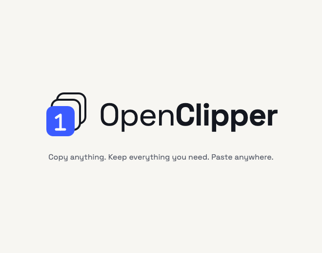

<div align="center">

  

  <br/>
  <br/>

  <p align="center">
    <strong>A lightning-fast, modal multi-copy-paste clipboard manager for macOS, Windows, and Linux.</strong><br/>
    <em>Eliminate back-and-forth window switching with conveyor belts, targeted slots, and intelligent modal key swallowing.</em>
  </p>

  <p align="center">
    <a href="https://github.com/junaidmirr/openclipper/releases"></a>
    <a href="LICENSE"></a>
    
    
  </p>

</div>

---

## 🌟 Highlights & Philosophy

Traditional clipboard managers force you to stop typing, open a bulky search panel, scroll through dozens of items, and press enter. 

**OpenClipper** works like muscle memory:
1. **Conveyor Belt (FIFO Auto Mode)**: Copy 4 items in a row (`Cmd+C` / `Ctrl+C`). Paste 4 times in a row (`Cmd+V` / `Ctrl+V`) to discharge Slot 1, then Slot 2, then Slot 3, then Slot 4.
2. **Targeted Modal Slots (No Number Typing)**: Activate a mode, then tap `1`–`9`. OpenClipper intercepts and **swallows** the keystroke so you never accidentally type numbers into your documents.
3. **Smart Cut with Copy Fallback**: `Cmd+X` or `Ctrl+Shift+X` cuts selected items, but if an item is read-only (webpages, PDFs, locked code), it **automatically falls back to Copying** seamlessly.
4. **Decoupled Cross-Platform Architecture**: The core headless engine is completely separated from the UI shell, allowing fast testing, zero UI overhead, and native performance on macOS, Windows, and Linux.

---

## 🚀 Operating Modes & Shortcuts

| Action | Shortcut | Description |
| :--- | :--- | :--- |
| **Auto Copy** | `Cmd + C` *(macOS)*<br/>`Ctrl + C` *(Win/Linux)* | Copies selection into the next available slot (1 ➔ 2 ➔ 3...). |
| **Auto Cut** | `Cmd + X` *(macOS)*<br/>`Ctrl + X` *(Win/Linux)* | Cuts selection into queue. **Automatically falls back to Copy** if item is read-only. |
| **Conveyor Paste** | `Cmd + V` *(macOS)*<br/>`Ctrl + V` *(Win/Linux)* | Pastes and pops Slot 1, shifting all remaining slots forward. |
| **Manual Copy Mode** | `Ctrl + Shift + C`<br/>*(or double-tap `C`)* | Activates Copy Mode. Tap `1`–`9` to save selection directly into that slot. |
| **Manual Cut Mode** | `Ctrl + Shift + X`<br/>*(or double-tap `X`)* | Activates Cut Mode. Tap `1`–`9` to cut selection into that slot (with Copy fallback). |
| **Manual Paste Mode** | `Ctrl + Shift + V`<br/>*(or double-tap `V`)* | Activates Paste Mode. Tap `1`–`9` to paste that specific slot repeatedly without popping. |
| **Toggle Floating HUD**| `Cmd + Shift + Space` *(macOS)*<br/>`Ctrl + Shift + Space` *(Win/Linux)* | Show or hide the compact floating clipboard HUD. |
| **Exit Active Mode** | `Escape` | Immediately returns to standard Auto Mode. |

---

## 🎨 Visual HUD & Preferences

<div align="center">
  
</div>

- **Ultra-Compact Floating Pill**: High-contrast, non-distracting 52px floating bar. Click-and-drag it anywhere on your screen.
- **Clean Design**: Solid clean white card, crisp black text, and vibrant orange icons and outlines.
- **Dark Mode & Accent Themes**: Built-in Dark Mode (OLED black) and custom accent colors (Orange, Electric Blue, Emerald Green, Royal Purple, Coral Red).
- **Adjustable Slots**: Choose 5, 7, 9, 12, or 15 memory slots.
- **Preferences Panel (`Cmd+,`)**: Configure double-tap sensitivity, FIFO vs LIFO queuing, autostart on system boot, and subtle audio feedback.

---

## 📦 Download & Installation

### Pre-built Binaries
Download ready-to-run installers and binaries for your platform from the **[Releases](https://github.com/junaidmirr/openclipper/releases)** page:

- **macOS**: `OpenClipper_universal.dmg` (Intel & Apple Silicon)
- **Windows**: `OpenClipper_x64-setup.exe` or `OpenClipper_x64.msi`
- **Linux**: `OpenClipper_amd64.AppImage` or `openclipper_amd64.deb`

> **Note for macOS Users**: On first launch, grant **Accessibility** permissions under *System Settings > Privacy & Security > Accessibility* so OpenClipper can intercept key shortcuts and swallow digit keys. OpenClipper includes a 1-click shortcut directly to this setting.

---

## 🛠️ Building from Source

### Prerequisites
- [Rust & Cargo](https://rustup.rs/) (edition 2024 / 1.80+)
- [Node.js](https://nodejs.org/) (v18+ recommended)
- Platform-specific tools:
  - **macOS**: Xcode Command Line Tools (`xcode-select --install`)
  - **Windows**: Visual Studio C++ Build Tools
  - **Linux (Ubuntu/Debian)**:
    ```bash
    sudo apt-get update && sudo apt-get install -y \
      libgtk-3-dev libwebkit2gtk-4.1-dev libappindicator3-dev librsvg2-dev \
      patchelf libxdo-dev libxtst-dev libevdev-dev
    ```

### Clone and Build
```bash
# Clone the repository
git clone https://github.com/junaidmirr/openclipper.git
cd openclipper

# Run unit tests across both engine and UI host
cargo test --workspace

# Build the complete release package
cargo build --release
```

---

## 🏗️ Architecture

OpenClipper is split into two cleanly decoupled components:

```
openclipper/
├── engine/                       # Headless Cross-Platform Backend Engine
│   ├── src/
│   │   ├── slots.rs              # FIFO / LIFO slot queues, dynamic capacity, serialization
│   │   ├── settings.rs           # Multi-platform config storage & autostart handlers
│   │   ├── clipboard/            # Safe text, thumbnailing images, and files (macOS / Win / Linux)
│   │   └── input/                # Native low-level hooks, key swallowing & keystroke simulation
│
├── src-tauri/                    # Lightweight Tauri v2 UI Host
│   └── src/lib.rs                # IPC commands, tray menu, window lifecycle
│
└── ui/                           # Frontend Webview HUD & Preferences
    ├── index.html / app.js       # Ultra-compact floating pill HUD
    └── settings.html / settings.js # Tabbed preferences window
```

---

## 🧪 CI / CD & Quality Assurance

All pull requests and commits are verified by automated GitHub Actions workflows:
- **`CI`**: Validates `cargo fmt`, `prettier` formatting, and runs unit tests across `macos-latest`, `windows-latest`, and `ubuntu-latest`.
- **`Release`**: Automatically builds and attaches signed production binaries for macOS, Windows, and Linux whenever a new `v*` tag is pushed.

---

## 📄 License

This project is licensed under the [MIT License](LICENSE) — free to use, modify, and distribute.
